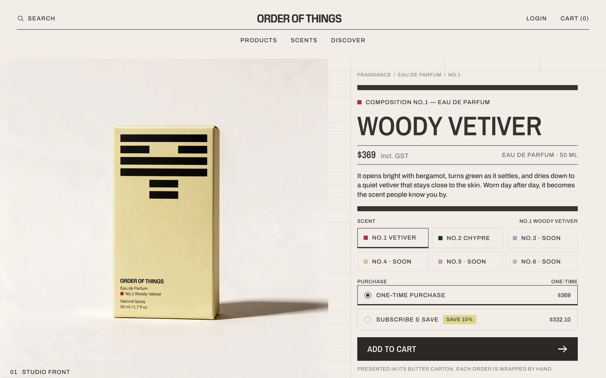
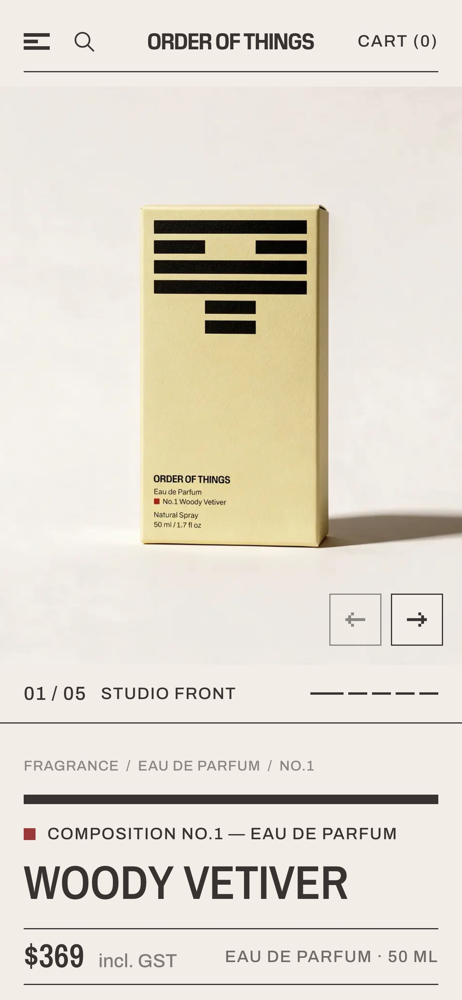
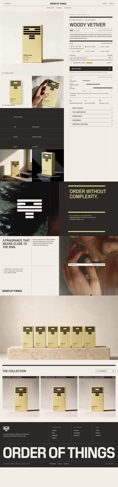
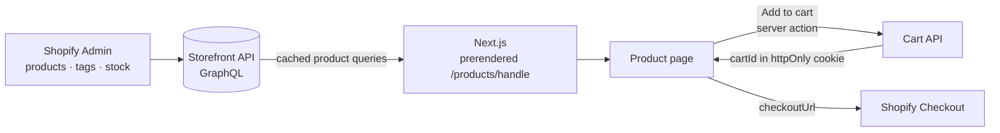

<div align="center">

# Order of Things: Headless Product Page

**A headless Shopify storefront for a fine-fragrance product page, built from a Figma design with Next.js and the Shopify Storefront API.**


### [🔗 View the live demo](https://order-of-things-headless.vercel.app/products/no-1-woody-vetiver)

<br />



</div>

<br />

## Overview

Order of Things sells six eau de parfum *compositions*, each in a printed butter carton. This repository turns the Figma product page into a production-ready headless storefront. Shopify owns the products, prices, availability and checkout, and Next.js renders the page.

Everything product-specific (title, price, description, scent notes, availability) comes live from Shopify. Releasing a new composition or marking one sold out is done in the Shopify admin, with no code change.

<p align="center">
  
  <br />
  <sub>Mobile · 390px</sub>
</p>

<details>
<summary><b>View the full page</b></summary>
<br />

</details>

## Features

| | |
|---|---|
| 🧴 **Scent selector** | Six compositions from the store. Switching scent swaps the page in place, with no reload and no scroll jump ("like turning the pages of one book"). Unreleased scents show as *Soon*, and out-of-stock ones as *Sold out*. |
| 🛒 **Real cart** | Shopify Cart API (`cartCreate` / `cartLinesAdd`) through a server action, with the cart id in an httpOnly cookie and a live count in the header. Checkout hands off to Shopify. |
| 🔁 **Subscribe & save** | One-time purchase, or subscribe with a 10% discount and a 1 / 2 / 3-month delivery frequency. The UI is ready to map to a Shopify selling plan. |
| 📌 **Sticky buy bar** | Slides up the moment the main *Add to cart* button scrolls under the header. It shares one purchase state with the panel, so both buttons always agree. |
| 📖 **Product story** | Scent notes timeline, assurances, a details accordion (one section open at a time), manifesto, brand story and the rest of the collection. |
| 📱 **Responsive** | Desktop (1440px) and mobile (390px) built to the design, including a swipeable mobile gallery. |
| ♿ **Accessible** | Real radio groups, `aria-expanded` / `aria-current` states, `inert` collapsed content, reduced-motion support and descriptive alt text. |
| ⚡ **Fast** | Every composition is prerendered, links fully prefetch, and each device downloads only the hero image it actually shows. |

## How it works



**Data conventions.** The page reads a few simple conventions from Shopify product tags:

| Tag | Meaning |
|---|---|
| `composition-1` … `composition-6` | Composition number: sort order, swatch color, labels |
| `coming-soon` | Unreleased: shown as *Soon* and not purchasable |
| `top:Bergamot` · `heart:Green Herbs` · `base:Vetiver` | Scent notes for the timeline and the notes panel |

Out-of-stock is read from Shopify's own `availableForSale`, so a released scent that sells out shows *Sold out*, never *Soon*.

## Project structure

```
.
├── storefront/                 Next.js app
│   ├── app/
│   │   ├── products/[handle]/  The product page (prerendered per composition)
│   │   ├── actions/cart.ts     Add-to-cart server action
│   │   ├── fonts.ts            Font setup (swap point for the brand fonts)
│   │   └── globals.css         Design tokens: colors and type scale
│   ├── components/
│   │   ├── product/            Gallery, buy panel, scent selector, purchase, sticky bar…
│   │   ├── sections/           Manifesto, brand story, six cartons, collection
│   │   ├── brand/              Shared brand primitives: grid, rule, swatch
│   │   ├── header/ · footer/
│   │   └── icons.tsx           Logo and line icons from the design
│   └── lib/
│       ├── shopify.ts          All Storefront API access (typed queries and mutations)
│       ├── composition.ts      Tag conventions → compositions, status, notes
│       └── cart.ts · money.ts · gallery.ts
├── shopify-import/
│   └── products.csv            The six compositions, ready for Shopify's product import
└── NOTES.txt                   Work notes: time log, challenges and decisions
```

## Getting started

**Requirements:** Node 20+ and a Shopify store with a Storefront API access token (for example from the free **Headless** sales channel).

```bash
git clone <this-repo>
cd <this-repo>/storefront
npm install
cp .env.example .env.local   # then fill in your store domain and token
npm run dev                  # http://localhost:3000
```

| Variable | Description |
|---|---|
| `SHOPIFY_STORE_DOMAIN` | e.g. `your-store.myshopify.com` |
| `SHOPIFY_STOREFRONT_ACCESS_TOKEN` | Public Storefront API token |
| `SHOPIFY_STOREFRONT_API_VERSION` | Optional, defaults to `2025-10` |

**Product data:** import `shopify-import/products.csv` from **Products → Import** in the Shopify admin, then make sure the products are available on the Headless sales channel.

> [!TIP]
> Prefetching only runs in production builds. To see instant composition switching, use `npm run build && npm start` rather than the dev server.

## Notes

- **Fonts:** the design uses Pilat and Pilat Narrow, which are commercial. Archivo and Archivo Narrow stand in for now, and swapping in the licensed files is a two-line change in `app/fonts.ts`.
- **Currency:** prices are formatted from the store's currency code, so the page shows A$ automatically once the store's base currency is AUD.
- **Subscriptions:** Shopify needs a subscription app to provide selling plans. Until one is installed, *Subscribe & save* is fully designed but kept out of checkout rather than faking the discount.

More detail on decisions, trade-offs and the time log is in [`NOTES.txt`](NOTES.txt).

<div align="center">
<br />
<sub>Design: Order of Things · Built by Chris Loui Canete</sub>
</div>
